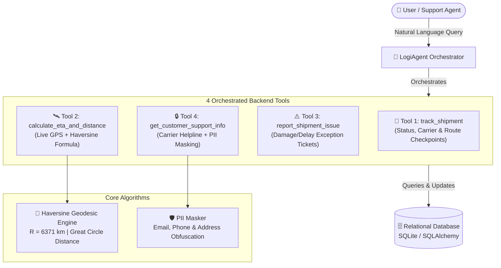

# 📦 LogiAgent: AI-Powered Logistics & Shipment Tracking Agent

> **An intelligent agent that tracks parcels, computes real-time geodesic ETAs from live GPS data streams, registers exception tickets, and protects sensitive customer data via PII masking.**

---

## 🌟 Overview (Explained Simply)

Imagine you ordered a package online. Usually, you have to open an app, copy a tracking number, find a tracking page, wonder why it says "In Transit", and call support if there is a delay.

**LogiAgent** acts like an intelligent logistics assistant working at the shipping headquarters:
1. You can talk to it naturally: *"Where is my package PKG-1001?"* or *"When will PKG-1001 arrive?"*
2. It looks at the real database and uses **4 backend tools** to get exact answers.
3. It takes the **live GPS satellite coordinates** of the delivery truck and destination city, uses a mathematical formula called the **Haversine formula** to measure real curvature-adjusted Earth distance, and estimates the exact arrival time.
4. When customer or courier details are displayed, it automatically **masks personal data (PII)** like phone numbers, street addresses, and emails so private information is never leaked.

---

## 🏗️ System Architecture



---

## 🎯 Key Project Features

### 1. 4 Orchestrated Backend Tools
- **`track_shipment`**: Fetches real-time status (`IN_TRANSIT`, `OUT_FOR_DELIVERY`, `DELAYED`, `DELIVERED`), carrier info, and chronological checkpoint journey.
- **`calculate_eta_and_distance`**: Gathers current live GPS telemetry (`latitude`, `longitude`) and destination coordinates, executing the Haversine formula to calculate geodesic distance in km/miles and projected arrival time.
- **`report_shipment_issue`**: Creates incident tickets (`DAMAGED`, `DELAYED`, `LOST`) in the database, updates parcel status, and alerts dispatchers.
- **`get_customer_support_info`**: Retrieves carrier customer care contact and recipient info while passing data through our PII security layer.

### 2. Relational Database Schema
Built with **SQLAlchemy** with relational models:
- **`customers`**: Customer profile, addresses, and contacts.
- **`carriers`**: Carrier profiles (`FedEx`, `UPS`, `DHL`) with average highway speed parameters.
- **`shipments`**: Origin, destination, live GPS coordinates, and delivery status.
- **`tracking_checkpoints`**: Historical time-stamped location waypoints.
- **`shipment_issues`**: Audit log of tickets and exceptions.

### 3. Haversine Distance & Real-Time ETA Computation
Calculates great-circle distance between two points on a spherical Earth:

$$\Delta\phi = \text{radians}(\text{lat}_2 - \text{lat}_1)$$
$$\Delta\lambda = \text{radians}(\text{lon}_2 - \text{lon}_1)$$
$$a = \sin^2\left(\frac{\Delta\phi}{2}\right) + \cos(\text{lat}_1) \cdot \cos(\text{lat}_2) \cdot \sin^2\left(\frac{\Delta\lambda}{2}\right)$$
$$d = 2 \cdot R \cdot \text{atan2}(\sqrt{a}, \sqrt{1-a})$$

Where Earth radius $R = 6371.0\text{ km}$. ETA is then dynamically calculated using the carrier's average velocity ($\text{km/h}$) plus any transit delays.

### 4. PII-Masking Logic
Ensures sensitive personal information is never exposed to LLMs or support logs:
- **Email Masking**: `alice.johnson@example.com` $\rightarrow$ `a***n@example.com`
- **Phone Masking**: `+1 (555) 349-8812` $\rightarrow$ `+1-***-***-8812`
- **Street Address Masking**: `1004 Elm Street, Apt 4B` $\rightarrow$ `*** Elm Street, Apt ***`

### 5. 9 Comprehensive Unit Tests
Covering all core logic before deployment:
- 3 tests for **Geolocation & Haversine Distance** (known distance validation, zero distance, coordinate boundary errors)
- 3 tests for **ETA & Speed Calculations** (standard transit math, invalid speed detection, arrival timestamps)
- 3 tests for **PII Obfuscation** (email patterns, phone patterns, recursive dictionary structures)

---

## 📁 Project File Structure

```text
LogiAgent/
├── data/                      # Local SQLite database directory
│   └── logiagent.db
├── src/
│   ├── __init__.py
│   ├── config.py              # Configuration & environment variables
│   ├── database/
│   │   ├── __init__.py
│   │   ├── models.py          # SQLAlchemy relational models
│   │   ├── connection.py      # Database session manager
│   │   └── seed_data.py       # Realistic logistics telemetry seed
│   ├── utils/
│   │   ├── __init__.py
│   │   ├── geo.py             # Haversine distance & ETA formulas
│   │   └── pii_masker.py      # Privacy masking algorithms
│   ├── tools/
│   │   ├── __init__.py
│   │   ├── tracking_tool.py   # Tool 1: Real-time tracking
│   │   ├── eta_tool.py        # Tool 2: Haversine ETA computation
│   │   ├── issue_tool.py      # Tool 3: Exception ticketing
│   │   └── support_tool.py    # Tool 4: Support info with PII masking
│   └── agent/
│       ├── __init__.py
│       └── orchestrator.py    # Dual-mode LangChain orchestrator
├── tests/
│   ├── __init__.py
│   ├── test_geo.py            # 3 Geolocation unit tests
│   ├── test_eta.py            # 3 ETA unit tests
│   └── test_pii.py            # 3 PII unit tests (Total: 9 tests)
├── .env.example               # Template environment variables
├── .gitignore                 # Standard Git ignore file
├── main.py                    # Interactive CLI & Demo runner
├── requirements.txt           # Python project dependencies
└── README.md                  # Project documentation
```

---

## 🚀 Quickstart Guide

### 1. Clone or Open the Repository
```bash
git clone https://github.com/<your-username>/LogiAgent.git
cd LogiAgent
```

### 2. Set Up a Virtual Environment (Recommended)
```bash
python -m venv venv

# On Windows:
venv\Scripts\activate

# On macOS/Linux:
source venv/bin/activate
```

### 3. Install Dependencies
```bash
python -m pip install -r requirements.txt
```

### 4. Configure Environment Variables (Optional)
```bash
cp .env.example .env
```
*(If you do not have an OpenAI API key, LogiAgent automatically runs in deterministic autonomous orchestration mode out of the box!)*

---

## 🧪 Running Unit Tests

Run the full suite of **9 unit tests**:

```bash
python -m pytest tests/ -v
```

Expected output:
```text
tests/test_eta.py::test_calculate_eta_standard PASSED                    [ 11%]
tests/test_eta.py::test_calculate_eta_invalid_inputs PASSED              [ 22%]
tests/test_eta.py::test_calculate_eta_future_timestamp_with_delay PASSED [ 33%]
tests/test_geo.py::test_haversine_known_coordinates PASSED               [ 44%]
tests/test_geo.py::test_haversine_same_coordinates_zero_distance PASSED  [ 55%]
tests/test_geo.py::test_haversine_invalid_coordinates_raises_error PASSED [ 66%]
tests/test_pii.py::test_mask_email_formats PASSED                        [ 77%]
tests/test_pii.py::test_mask_phone_number_formats PASSED                 [ 88%]
tests/test_pii.py::test_mask_pii_dictionary_recursive PASSED             [100%]

============================== 9 passed in 0.48s ==============================
```

---

## 💻 Running the Application

### Option A: Run the Automated Showcase (All 4 Tools)
```bash
python main.py --demo
```

### Option B: Interactive Terminal Assistant
```bash
python main.py
```

Try asking:
- `"Where is package PKG-1001 right now?"`
- `"What is the ETA for shipment PKG-1001?"`
- `"Package PKG-1002 was damaged during delivery, please report an issue."`
- `"Can you provide the carrier support phone and recipient details for PKG-1004?"`

---

## 📤 Step-by-Step GitHub Deployment Guide

Follow these exact steps to push this project to your GitHub account:

### Step 1: Initialize Git in your project folder
```bash
git init
```

### Step 2: Add all files & make your initial commit
```bash
git add .
git commit -m "feat: initial commit for LogiAgent with 4 orchestrated tools, Haversine ETA, and 9 unit tests"
```

### Step 3: Create a new repository on GitHub
1. Go to [github.com/new](https://github.com/new).
2. Repository name: `LogiAgent`.
3. Set visibility to **Public** (or **Private**).
4. Leave *"Add a README"*, *".gitignore"*, and *"license"* **UNCHECKED** (since we already have them).
5. Click **Create repository**.

### Step 4: Link and Push to GitHub
```bash
git branch -M main
git remote add origin https://github.com/<YOUR_GITHUB_USERNAME>/LogiAgent.git
git push -u origin main
```

🎉 **Congratulations! Your project is now live on GitHub!**

---

## 📄 License
This project is open-source under the MIT License.
